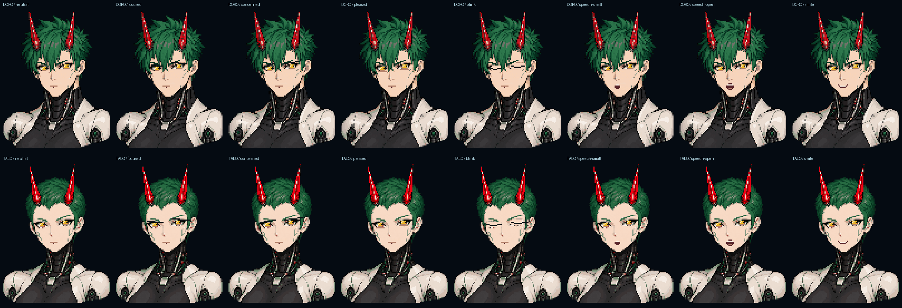

# KIKAI license portrait assets

DORA, DORO and TALO are three distinct portrait types. DORA reuses the approved
long-hair portrait and fixed guide art. This pack adds DORO's short spiky crown,
angular face and wider mechanical neck, and TALO's low crew cut, exposed forehead
and compact face. Neither is a recolored DORA. Type choice does not assign a
gameplay bonus. The creation UI uses only the names DORA, DORO and TALO.

The two references were generated with the built-in `image_gen.imagegen` tool
on 2026-10-11 using the original DORA sheet as a style reference. Their exact
prompts, source hashes and tool provenance are in
`assets/concepts/kikai/profiles/generation.json`. The tool supplied no model
identifier; this record does not infer an independent licensing guarantee. The
original approved DORA reference and all historical guide proofs are unchanged.

## Conversion and authoring

`scripts/asset-kikai-profiles.py` makes the conversion reproducible. It requires
the reviewed 1086×1448 source and recorded source hash. It thresholds alpha at128,
retains all connected components, takes the occupied bounding box, uniformly
fits it into96×128 using nearest-neighbor sampling and centered integer padding,
and quantizes occupied colors to47 without dithering. Output width/height
rounding is recorded. This raster-to-cell step is lossy; it is not a perfect or
lossless conversion of generated art.

The fitted DORO image is96×123 at offset0,2; TALO is96×125 at offset0,1. The
conversion changes6,543 and5,545 occupied color cells respectively. These
counts precede the deliberately authored gold iris, expression and mouth
patches. Full conversion records are in the per-type `provenance.json` files.

The ten authored96×128 PNG layers are body, five eye states (neutral, focused,
concerned, pleased, blink), and four mouth states (rest, small, open, smile).
They are imported exactly by the existing offline asset-pack tool with an
explicit54-entry palette, including transparent index0. No resize, alpha
change or component removal happens during that subsequent import. Indexed
PNG unpack/repack preserves every authored index and palette entry.

| Type | Body | Eye layer | Mouth layer | Total occupied cells | Hair / crystal / signal roles |
| --- | ---: | ---: | ---: | ---: | --- |
| DORO | 6,481 | 252 | 96 | 6,829 | 1,580 / 272 / 172 |
| TALO | 5,516 | 415 | 104 | 6,035 | 947 / 308 / 134 |

Each pose has the same occupied mask. Body, eyes and mouth are disjoint; facial
animation recolors existing cells without changing the silhouette. Roles are
sorted occupied body-cell indices: hair follows the main manufacturer, crystal
horns follow the sub manufacturer, and animated signals are a subset of the
crystal mask. Neck cables and eyebrows do not inherit hair color. The baseline
is PAN green hair and RENKO red crystals, with gold eyes, ivory armor and dark
mechanical recesses. DORA's fixed guide identity remains APR-1337 /
DORA-PAN-RENKO-1337; a licensed DORO/TALO profile is not that guide.

## Native integration contract

`assets/ui/kikai/profiles/atlas.json` has outer `version:1` and `profiles` keyed
`doro` and `talo`. Each independent pack contains `version`, `palette`, `sprites`
and `portrait_roles` with `source_size:[96,128]`, `default_main:"PAN"`,
`default_sub:"RENKO"`, `hair_cells`, `horn_cells` and `signal_cells`. Sprite keys
are exactly `body`, `eyes_neutral`, `eyes_focused`, `eyes_concerned`,
`eyes_pleased`, `eyes_blink`, `mouth_rest`, `mouth_small`, `mouth_open` and
`mouth_smile`. Cells are row-major palette indices and colors are little-endian
RGBAu32. `asset_metadata` records authoring/import evidence and is not a
gameplay or animation driver.

The engine specialist owns the cached PixelBody adapter and profile portraitID9:
type0 DORA,1 DORO,2 TALO; corporation0 PAN,1 RENKO,2 HUGO. Invalid tokens must skip
drawing rather than substitute the wrong portrait type. Continuous fractional
fit retains all cells at48×64 or smaller display rectangles. The host chooses
expression, actual speaking state, time and Reduced Motion; metadata alone
does not animate. Each portrait submits three layer transforms. All occupied
submissions, including cells masked by clipping, must count against both
existing pixel and work budgets; real clipping and atomic budget admission stay
in the native adapter. There is no new minimum cell size or silent low-detail
fallback in this asset pack.

## Reproduce and review

Use Python3.12.10 and the existing pinned Pillow requirement:

```powershell
python -m pip install -r scripts/asset-requirements.txt
python scripts/asset-kikai-profiles.py
python scripts/asset-kikai-profiles-tests.py
```

The eleven focused tests validate the pinned references, exact authored/imported
and indexed round-trip cells, declared conversion loss, all20 eye/mouth pose
combinations, disjoint color roles, different silhouettes, gold eyes, palette
and occupied-work bounds, and rejection of malformed layer/role input. The
checked authoring contact sheet is composed from those PNGs with nearest3×
scaling. It is an asset review image, not a GPU or browser capture.

The engine specialist separately reported33 actual native Kikai tests passing
with these packs, including cached PixelBody extraction, distinct type/corporate
signatures, partial clipping, reflected affine transforms and tiny continuous
fit. That is peer execution evidence, not an extra test run by the art author.
Root retains normal-build, browser, live selection and physical-device acceptance
ownership. Subjective portrait approval, browser animation, exact small-display
readability and device performance remain pending until those are observed.


