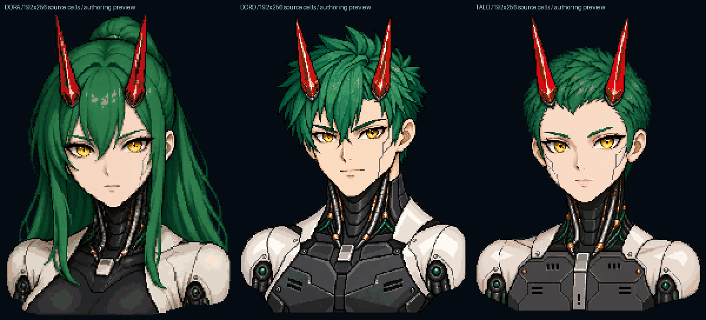

# KIKAI license portrait assets

The current portrait pack contains three independently authored 192×256 types:
DORA with the approved feminine face and long hair, DORO with a masculine face
and short spiky crown, and TALO with a neutral face and low crew cut. DORO and
TALO have flat mechanical sternum plates, straight panel seams and inset vents;
their chests do not reuse DORA's rounded breast armor. Type choice does not
assign a gameplay bonus. The creation UI uses DORA, DORO and TALO as its labels.

The fixed guide is APR-1337 / DORA-PAN-RENKO-1337: PAN green long hair and RENKO
red crystal horns. Hair follows the main manufacturer and horns follow the sub
manufacturer for licensed profiles. Gold irises, ivory shoulder armor and dark
mechanical necks remain independent of those two color roles.

## Sources and conversion

The DORO and TALO sources were edited with the built-in `image_gen.imagegen`
tool on 2026-10-11 to correct torso anatomy while retaining their respective
faces, haircuts and mechanical detail. Exact prompts, input/output hashes and
tool provenance are in `assets/concepts/kikai/detail/generation.json`. The tool
provided no model identifier; the record does not infer a licensing guarantee.
DORA is converted directly from the first portrait of the approved original
1881×836 expression sheet. That reference bitmap is unchanged. The new pack is
not an enlargement of the historical 96×128 cells.

`scripts/asset-kikai-detail.py` pins the reviewed source dimensions and hashes,
thresholds alpha at 128, retains all connected components, crops the occupied
bounds and uniformly fits them into 192×256 with nearest-neighbor sampling and
centered integer padding. DORA uses the first 627×836 source region and fits
192×256 at 0,0; DORO fits 192×252 at 0,2; TALO fits 192×249 at 0,3. Integer aspect
rounding, original partial alpha and occupied-color changes are recorded in
each type's `provenance.json`.

The raster conversion is lossy. It uses 55-color median-cut quantization without
dithering, explicit eye-region palette weighting, and four authored golden iris
tones selected from the source iris mask. Fine one-cell facial contours and
catchlights are then authored at the192 grid. Neutral/rest retains the fitted
reference except at most six iris accents; all chest cells retain the converted
source. Blink and speech states keep the same occupied mask and do not alter
the silhouette or torso.

Ten binary-alpha PNG layers per type are imported by the existing offline
asset-pack tool: body, five eyes (neutral, focused, concerned, pleased, blink)
and four mouths (rest, small, open, smile). This subsequent import performs no
resize, alpha change or component removal. Indexed PNG unpack/repack preserves
every authored index and palette entry.

| Type | Body | Eyes | Mouth | Total occupied cells | Palette entries | Hair / horn / signal roles |
| --- | ---: | ---: | ---: | ---: | ---: | --- |
| DORA | 32,764 | 1,416 | 414 | 34,594 | 63 | 14,556 / 1,139 / 740 |
| DORO | 26,558 | 1,462 | 504 | 28,524 | 61 | 6,015 / 1,219 / 622 |
| TALO | 22,518 | 1,240 | 504 | 24,262 | 60 | 3,814 / 1,567 / 664 |

Every one of the 60 type/eye/mouth combinations has mutually disjoint body,
eyes and mouth layers with unchanged occupied positions. Roles are sorted
occupied body indices. Hair and horns are disjoint; animated signals are a
subset of horns. Neck cables and eyebrows do not inherit hair color.

## Native integration contract

`assets/ui/kikai/detail/atlas.json` has outer `version:1` and `profiles` keyed
`dora`, `doro` and `talo`. Each independent pack contains `version`, `palette`,
`sprites`, `portrait_roles` and `asset_metadata`. Every sprite is 192×256;
`portrait_roles.source_size` is `[192,256]`, with `default_main:"PAN"`,
`default_sub:"RENKO"`, `hair_cells`, `horn_cells` and `signal_cells`. Sprite keys
are exactly `body`, `eyes_neutral`, `eyes_focused`, `eyes_concerned`,
`eyes_pleased`, `eyes_blink`, `mouth_rest`, `mouth_small`, `mouth_open` and
`mouth_smile`. Cells are row-major palette indices; colors are little-endian
RGBAu32 with transparent index 0. The runtime JSON uses compact separators
and a final LF; readable provenance remains in separate files. Removing JSON
whitespace changes no cells or schema. Scoped Git attributes preserve JSON LF
on Windows and Linux. Metadata records authoring evidence;
it does not select poses or drive gameplay.

The engine specialist owns the dimension-driven cached PixelBody adapter:
portrait ID8 is the fixed guide and ID9 is a licensed profile. Type 0 DORA,
1 DORO, 2 TALO and corporation 0 PAN, 1 RENKO, 2 HUGO are explicit tokens. Invalid
tokens skip drawing rather than substituting another type. Continuous
fractional fits retain fine source cells without a minimum cell size or silent
low-detail fallback. The host selects expression, actual speaking state, time
and Reduced Motion. Each portrait submits three layer transforms.

All occupied submissions, including cells masked by clipping, count against
the pixel and work budgets. Whole portraits require atomic admission and
four-corner clipping in the native adapter. The shared UI cap remains 60,000:
DORA plus DORO alone require 63,118 cells, so simultaneous admission cannot be
assumed. The adapter must reject an unaffordable whole portrait rather than
partially draw its face. The 49,152-cell source-area ceiling is a per-portrait
bound, not additional capacity. Physical UI raster integration is separate
from this asset authoring task.

## Reproduce and review

Use Python 3.12 and the pinned Pillow 12.3.0 requirement (CI pins Python 3.12.10):

```powershell
python -m pip install -r scripts/asset-requirements.txt
python scripts/asset-kikai-detail.py
python scripts/asset-kikai-detail-tests.py
```

All 12 focused Python tests passed locally on 2026-10-11 with Python 3.12.14
and Pillow 12.3.0. They verify source
provenance, committed-atlas equality against source regeneration, exact PNG
import/indexed roundtrip, declared conversion loss, all 60 constant/disjoint
pose masks, neutral/chest preservation, distinct type silhouettes, gold irises,
independent roles, palette/occupied bounds, and malformed-input rejection.
They do not certify anatomy, execute the native adapter or measure a device.

Root and the gameplay specialist independently viewed the corrected full-size
sources and authored 192×256 overview. Their scoped visual review found flat
mechanical chests in DORO/TALO and the retained feminine DORA silhouette. The
gameplay specialist also inspected the state contact sheet and found no
obvious facial-layer misalignment. These are source-art reviews, not browser
rendering or human playthrough acceptance.

The checked overview and contact sheet are composed from the authored PNGs at
nearest 2× scale. Actual native integration, physical UI detail retention,
small-display readability, blink/speech playback, normal WebGPU/WebGL2
presentation and physical-device performance require separate validation.



## Preserved history

`assets/ui/kikai/profiles/` retains the previous 96×128 DORO/TALO pack and its
generation/import evidence. Its 6,829/6,035 occupied counts and 33 native checks
belong to that earlier milestone. The original 96×128 DORA and all earlier
guide proof sets remain historical. The new detail pack replaces portrait art
after native integration; the old pack's original icon assets remain a
separate runtime dependency. Historical images are not evidence that the new
192×256 portraits have rendered in a browser.
