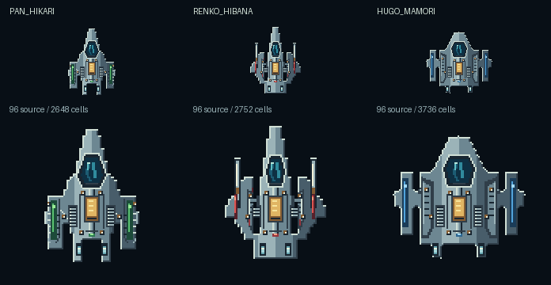

# Corporate RAICHO fine source surfaces

This is proposed source art for task-78313163, authored on 2026-10-11 from the
reviewed runtime baseline `f69d6cbe8d58d182da6e45460b42b963655c5fbc`.
It does not replace a gameplay body or install an animation. Native extraction,
collision/damage integration, normal GPU presentation, human readability and
physical-device budgets remain separate acceptance gates.

The [96-cell pack](../assets/pixels/raicho-fine-detail/atlas.json) contains three
overhead surfaces: PAN HIKARI, RENKO HIBANA and HUGO MAMORI. Each has a distinct
existing silhouette and manufacturer trim. New canopy seals, fine glass glints,
rail collars, recessed cooling cassettes, shield-deck plates, flush reactor
windows, nozzle lips and small fasteners are authored at the new resolution.
They use the same restrained alloy/recess/indicator language as the
[64-cell controls](FLIGHT_ICON_ART.md) and the
[192-cell KIKAI benchmark](KIKAI_PROFILE_ART.md). No raster model was used.



The top row is exactly one output pixel per source cell; the bottom row is a
declared 2× nearest enlargement. This is a software authoring sheet, not native
engine extraction or a game screenshot. [Compact review](../assets/pixels/raicho-fine-detail/compact-review.png)
shows separately sampled 29/48/77-pixel surfaces and isolated fine overlays.
These deliberately small software samples disclose detail loss. They are not
a measured game zoom, DPR, frame time or display-size guarantee. A fine overlay
is transparent between assemblies and requires a retained base body.

## Two presentation options, unchanged collision contract

All six sprites are 96×96 row-major indexed cells with transparent index 0.
The palette contains 32 little-endian RGBA values, including transparency;
all occupied values have alpha 255. Source PNG import is exact: no resize,
quantization, alpha threshold, removed component or hidden-RGB change.

| Manufacturer | Retained 48-cell reference | Full fine surface | Added fine overlay | Retained body + overlay | Signal cells |
| --- | ---: | ---: | ---: | ---: | ---: |
| PAN HIKARI | 662 | 2,648 | 1,205 | 1,867 | 31 |
| RENKO HIBANA | 688 | 2,752 | 1,176 | 1,864 | 27 |
| HUGO MAMORI | 1,040 | 3,736 | 1,740 | 2,780 | 31 |

The first future option retains the existing 48×48 collision/presentation base
and appends only `*_fine`. The second draws the standalone full fine surface,
while preserving the separately reviewed gameplay body until a collision
change is explicitly accepted. These are alternatives. Drawing the full fine
surface and its matching fine overlay together repeats cells and colors; it
is not the intended detail path. Both options preserve the same centered
coordinate origin and existing actor world scale.

`asset_metadata.groups` demonstrates an authoring transform with basis
`[0.5,0] / [0,0.5]`. A fine cell's local corner is
`[(source_x-48)/2,(source_y-48)/2]`, before the actor's existing affine transform.
There is no minimum cell size, resolution-dependent collider, or coarse LOD in
this pack. A future adapter must compose complete matrices, including parent
reflection, shear and nonuniform scale; occupied bounds use every cell's four
corners. These groups are opt-in authoring metadata, not automatically consumed
by the present game loader.

Every fine occupied cell maps into an occupied reference cell by
`[floor(source_x/2), floor(source_y/2)]`. On destruction of a coarse cell, the
host must hide all mapped fine cells for that coarse cell. This includes full
fine presentation if that option is chosen. Never restore destroyed material
or fill an aperture merely because the source pack is intact. The authored
tests exercise the proposed mapping; no live projectile/damage integration
test ran for this source-only milestone.

PAN and RENKO full surfaces retain the exact 2× reference occupancy envelope.
RENKO's reviewed rail geometry already contains 24 enclosed transparent coarse
cells; those deliberate apertures remain 96 fine cells. They are explicitly
`holes-allowed`, while the material is still one four-neighbor connected body.
PAN has no enclosed holes. HUGO's 4,160-cell exact duplicate would exceed the
4,000-cell target, so its proposed full surface uses a declared one-fine-cell
perimeter inset. Four connected original extrema remain, and no cell extends
outside its old occupied envelope. HUGO remains connected with no enclosed
holes. This inset changes proposed presentation material, not gameplay.

Each full surface stays below 4,000 submitted cells. Each overlay stays below
1,800, leaving the largest retained-body option at 2,780 cells/two transforms.
Every repeated instance costs its occupied cells again; clipping and alpha-zero
masking do not provide free submission budget. A future adapter must preflight
the complete object before appending, preserve existing frame caps and split
valid transform batches when necessary. There is no partial-detail admission
or silent replacement in this source pack.

## Material masks and relative animation contract

Each sprite's `material_cells` is a sorted, disjoint partition of all occupied
positions. Its seven roles are `metal`, `recess`, `glass`, `main_accent`,
`reactor`, `exhaust` and `fastener`. Shared neutral alloy, dark glass, brass and
exhaust colors remain separate from each manufacturer's four accent shades.
Manufacturer recoloring must use the explicit `main_accent` mask, never a broad
hue predicate. It must not tint canopy glass, neutral deck plating or bolts.
Sub manufacturer is a KIKAI crystal-horn role, not a second hull palette or
an extra gameplay bonus.

`fine_cells` selects exactly the assemblies stored in the matching overlay.
`signal_cells` is a much smaller subset of explicit accent/reactor/exhaust
positions. The source marks only stable occupied lamps and emitter cells; it
does not contain moving geometry or a particle loop. A future host may use real
thrust, hit or equipment state for signal color/emission, and may add a bounded
cosmetic local phase. Reduced Motion freezes that cosmetic phase while keeping
actual state information. Do not pulse the whole alloy/glass body, simulate a
new weapon, or derive a gameplay effect from this authoring metadata.

Handpicked tests locate the canopy glass at `(47,30)`, a flush reactor signal
at `(47,54)`, adjacent cooling rib/channel cells at `(35,58)/(35,59)`, distinct
manufacturer trims, forward rail caps, shield-deck vents, fastening highlights
and aft emitter cells. More than 450 source 2×2 blocks per surface have varied
colors. This is independently authored fine structure, rather than a nearest
enlargement of the old 48-cell RGBA image or random texture noise.

## Reproduce and review

Use Python with the repository's pinned [Pillow requirements](../scripts/asset-requirements.txt).
The source scripts use the existing exact cell pack importer and deterministic
PNG writer. The writer emits fixed filter-0 scanlines and stored DEFLATE blocks,
so linked compression libraries cannot change source/preview PNG fingerprints.
The pack folder enforces LF JSON checkout. Source-code provenance fingerprints
explicitly normalize CRLF to LF; source PNG, manifest and atlas fingerprints
remain exact raw bytes.

```powershell
python -m pip install -r scripts/asset-requirements.txt
python scripts/asset-raicho-fine-tests.py
# Regenerate into a review directory first; compare before replacing the pack.
python scripts/asset-raicho-fine.py --output work/raicho-source-review
```

[Provenance](../assets/pixels/raicho-fine-detail/provenance.json) records the
reviewed geometry commit, actual source/script hashes, conversion policy and
measured counts. The scoped tests compare all committed atlas/manifest/
provenance bytes, six source PNGs and both review PNGs to regeneration; check
RGBA and indexed PNG roundtrips, hard alpha, original f32 silhouette formulas,
roles/landmarks/topology, repeated-instance costs, four-corner affine bounds,
damage mapping and malformed data rejection. Generic `asset-pack.py unpack`
preserves exact dimensions/palette/indices and the top-level `raicho_detail`
extension; it does not preserve the sprite-level role masks. Keep the original
authored JSON for those masks rather than claiming a full metadata roundtrip.

This milestone is source-art and conversion acceptance only. Normal native
extraction, gameplay/damage mapping, fractional GPU sampling, relative signal
animation, human compact readability and dense mobile-scene performance have
not been accepted here. No existing release is described as using these cells.
